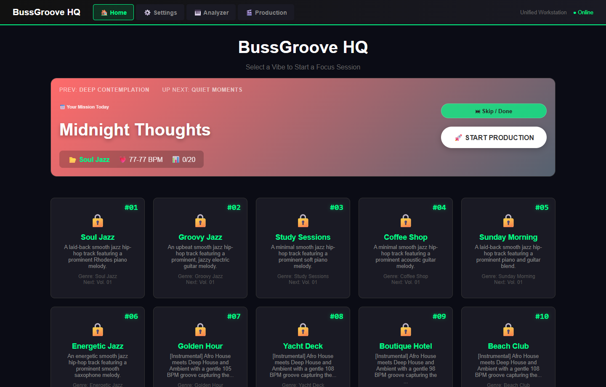
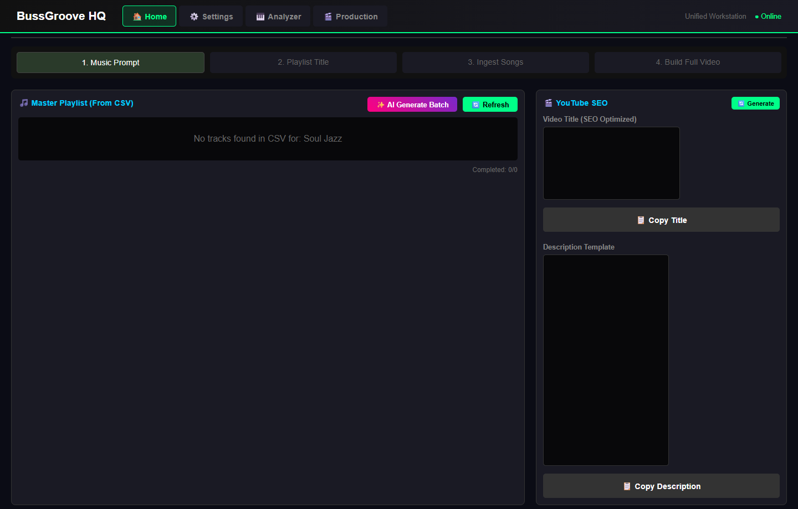
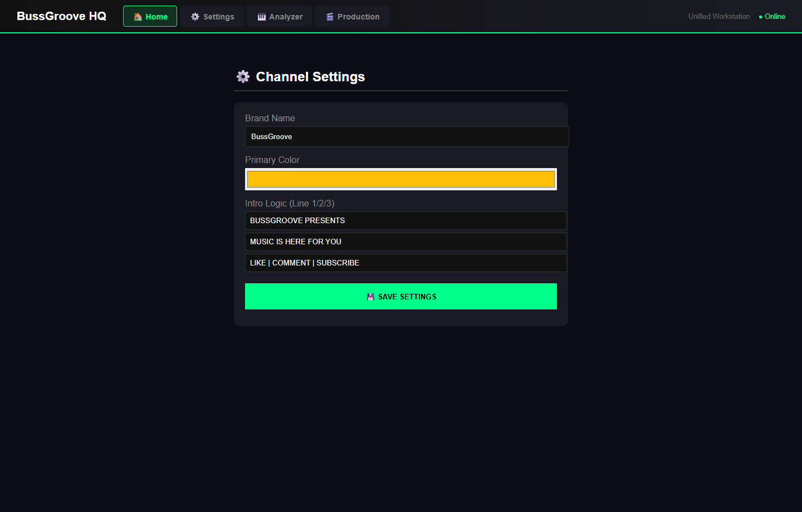
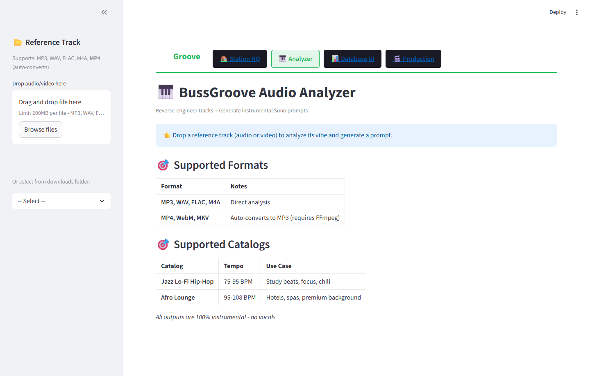

# GrooveStation Pro (`BussGroove`) — White-Label B2B AI Audio DSP, Prompt Engineering & Media Automation SaaS

[-10b981?style=for-the-badge&logo=windows)](https://github.com/KhaieJay1/groovestation-ai-prompt-engine/releases/tag/v1.0.0)

**Author:** Kayode Joseph Afuvape, CCIBS  
**Architecture:** Full-Stack Multi-Tenant B2B SaaS, Audio DSP Sonic Reverse-Engineering Engine, Constraint-Driven LLM Prompt Engineering Engine & Standalone Desktop Application  
**Frontend Stack:** Next.js 16 (App Router), React 19, TypeScript 5, Tailwind CSS v4, Lucide-React, Streamlit (`analyzer-dsp/`), plus Flask HTML5/JS White-Label Designer UI (`backend-engine/`)  
**Backend & AI Stack:** Python 3.13, `librosa` Audio DSP (HPSS + Krumhansl-Schmuckler Key Detection), Local Ollama (`llama3.2`), SQLite (`better-sqlite3` & `sqlite3`), YAML/JSON Constraint Schemas (`sound_locks.json`, `prompts.yaml`), `mutagen` ID3 Tagging, FFmpeg 4K Rendering, PyInstaller (`GrooveStation_Pro.exe`)

---

## Live Application Screenshots

### 1. GrooveStation Pro HQ — Multi-Genre Sound Lock Matrix (`#01`–`#10`)


### 2. 4-Step Production & MMQ Compliance Workspace (`Prompt` → `Playlist` → `Ingest` → `4K Render`)


### 3. White-Label B2B Multi-Brand Configuration & Visual Identity Engine


### 4. BussGroove Audio DSP Analyzer (`librosa` HPSS + Krumhansl-Schmuckler Key Detection & 9-Section Prompt Generator)


---

## 1. Executive Summary & Commercial Problem Statement

In commercial generative AI audio production, **free-text prompting suffers from severe "prompt drift"**—producing inconsistent tempos, unwanted vocal artifacts, and unpredictable instrumentation that fail platform monetization and brand consistency standards.

**GrooveStation Pro** (incubated under the **BussGroove** commercial media brand) solves this by combining four production-grade subsystems:
1. **Audio DSP Sonic Reverse-Engineering (`analyzer-dsp/` — `librosa` + Krumhansl-Schmuckler Algorithm):** Uses Harmonic-Percussive Source Separation (`librosa.effects.hpss`), Constant-Q Chromagram correlation against Krumhansl-Schmuckler cognitive key profiles (`librosa.feature.chroma_cqt`), onset beat tracking, RMS energy extraction, and spectral centroid brightness analysis to reverse-engineer any reference audio/video file into a locked **Style Prompt** and a **9-Section Musical Arrangement Template** (`[Intro]` through `[Outro]`).
2. **Constraint-Driven LLM Prompt Guardrails (`SoundLockManager` & `SmartSunoGenerator`):** Eliminates free-text prompting by compiling every prompt through a deterministic 6-block schema via local **Ollama (`llama3.2`)** and programmatically stripping forbidden tokens (`vocals`, `heavy distortion`, `EDM drops`) before generation across **11 commercial genre verticals**.
3. **Mandatory Minimum Monetization Quality (MMQ $\ge 90\%$) Compliance Gate:** Enforces a pre-rendering quality assurance gate that blocks any audio asset failing sonic consistency ($\ge 90\%$), loop tolerance (30–60 min), or audio clipping checks from entering the 4K FFmpeg rendering pipeline.
4. **White-Label B2B Multi-Brand Architecture & Public Standalone App:** Allows B2B operators, agencies, and record labels to dynamically switch brand identities (`settings.json` / `sound_locks.json`), typography, color palettes, and 3-tier operator permissions (`CORE`, `ADVANCED`, `PRO`) via a Next.js 16 / React 19 workstation, a Flask web server, or the publicly downloadable standalone Windows executable ([`GrooveStation_Pro v1.0.0`](https://github.com/KhaieJay1/groovestation-ai-prompt-engine/releases/tag/v1.0.0)).

---

## 2. System Architecture

```text
┌───────────────────────────────────────────────────────────────────────────────────┐
│        NEXT.JS 16 (APP ROUTER) + REACT 19 + FLASK WHITE-LABEL WORKSTATION UI      │
│  - `/prompts` | `/styles` | `/inspirations` | `/songs` | `/kpis`                  │
│  - Next.js Server API Routes (`/api/ollama/generate`, `/api/database/*`)          │
└───────────┬───────────────────────────────┬───────────────────────────┬───────────┘
            │                               │                           │
            ▼                               ▼                           ▼
┌───────────────────────┐   ┌───────────────────────────────┐   ┌───────────────────┐
│ AUDIO DSP ANALYZER    │   │ SOUND LOCK & PROMPT R&D       │   │ MMQ GATE & 4K     │
│ (`analyzer-dsp/`)     │   │ (`agent_service.py` / Ollama) │   │ (`orchestrator`)  │
│ - Librosa HPSS        │   │ - 6-Block Deterministic Schema│   │ - MMQ >= 90% Gate │
│ - Krumhansl-Schmuckler│   │ - BPM / Key / Lead Mutation   │   │ - ID3 (`mutagen`) │
│   Chromagram Key Est. │   │ - Regex Negative Sanitizer    │   │ - 4K/60fps FFmpeg │
│ - 9-Section Template  │   │ - YouTube SEO Generator       │   │ - White-Labeling  │
└───────────────────────┘   └───────────────────────────────┘   └───────────────────┘
```

### The 6-Block Deterministic Prompt Architecture
All prompts generated by `SmartSunoGenerator` (`backend-engine/agent_service.py`) and `SoundLockManager` (`backend-engine/sound_lock_manager.py`) enforce a strict, non-negotiable structure:
```text
[CORE GENRE] -> [ENERGY & TEMPO BAND] -> [LOCKED INSTRUMENTATION] -> [MOOD & ATMOSPHERE] -> [STRUCTURE RULES] -> [NEGATIVE CONSTRAINTS]
```

---

## 3. Repository Structure

```text
groovestation-ai-prompt-engine/
├── frontend-nextjs/                    # Next.js 16 (App Router) + React 19 + TypeScript 5 Dashboard
│   ├── src/
│   │   ├── app/
│   │   │   ├── page.tsx                # Unified Production Workstation & Priority Queue
│   │   │   ├── prompts/page.tsx        # Prompt Engineering & Mutation Management View
│   │   │   ├── styles/page.tsx         # Sound Lock Style & Genre Matrix
│   │   │   ├── inspirations/page.tsx   # Reference Track Reverse-Engineering Library
│   │   │   ├── songs/page.tsx          # Track Catalog & Ingestion Status
│   │   │   ├── kpis/page.tsx           # Production Velocity & Catalog Completion KPIs
│   │   │   └── api/                    # Next.js Route Handlers (Ollama LLM, SQLite DB, Styles)
│   │   ├── components/                 # PromptCard, StyleCard, InspirationCard, SongModal, Sidebar
│   │   ├── lib/db.ts                   # `better-sqlite3` WAL-mode Database Layer
│   │   └── types/db.ts                 # TypeScript Interfaces for Tracks, Styles & Playlists
│   └── package.json
├── backend-engine/                     # Python 3.13 White-Label Engine, Flask UI & Prompt Guardrails
│   ├── agent_service.py                # `SmartSunoGenerator` & `YouTubeMetadataGenerator` (Ollama llama3.2)
│   ├── sound_lock_manager.py           # `SoundLockManager` JSON Profile Enforcer & Token Validator
│   ├── app.py                          # Flask White-Label Designer & Production Server
│   ├── orchestrator.py                 # End-to-End Audio-to-4K Video Pipeline Orchestrator
│   ├── video_generator.py              # FFmpeg 4K Visualizer & Typography Rendering Engine
│   ├── audio_processor.py              # Audio Normalization & Concatenation Engine
│   ├── sound_locks.json                # Sample 3-Genre Sound Lock Constraint Profiles
│   ├── prompts.yaml                    # Sample Genre Mutation & SEO Keyword Schema
│   └── GrooveStation_Pro.spec          # PyInstaller Standalone Executable Specification
├── analyzer-dsp/                       # Librosa Audio DSP Reverse-Engineering & Prompt Generator
│   ├── app.py                          # Streamlit Audio/Video Upload & Prompt Synthesis Dashboard
│   ├── audio_processor.py              # Librosa HPSS, Krumhansl-Schmuckler Key & Spectral Centroid DSP
│   ├── prompt_generator.py             # Automated Style Prompt & 9-Section Song Arrangement Compiler
│   └── requirements.txt
└── docs/                               # Commercial & Technical Architecture Specifications + Screenshots
    ├── screenshots/                    # Live Application UI Captures
    ├── PRODUCT_SPECIFICATION.md        # GrooveStation Pro v1.0 Enterprise Specification
    ├── MUSIC_INTELLIGENCE_SPEC.md      # Sound Lock, Prompt Mutation & MMQ Gate Architecture
    ├── STRATEGIC_BRIEF.md              # Monetization Standard & 3-Tier Access Control Model
    ├── TECHNICAL_BRIEF.md              # 4K Visual Identity, Typography & Timing Spec
    └── FEATURES_TABULATION.md          # Enterprise Multi-Tenant & Analyzer Workflow Spec
```

---

## 4. Scope & Intellectual Property Note
* **Public Standalone App Available:** End users and evaluators can download the pre-compiled Windows standalone application (`GrooveStation_Pro_v1.0.0_Windows_x64.zip`) directly from the [GitHub Releases page](https://github.com/KhaieJay1/groovestation-ai-prompt-engine/releases/tag/v1.0.0).
* To protect commercial client configurations and proprietary catalog assets, the repository source includes a **3-genre showcase subset** in `backend-engine/sound_locks.json` and `backend-engine/prompts.yaml` (out of the full 11-genre, 598-track, 128-playlist production catalog) and omits all third-party OAuth credentials.

---

## 5. Quick Start

### Option A: Download Standalone Windows App (No Python Install Required)
1. Download `GrooveStation_Pro_v1.0.0_Windows_x64.zip` from [Releases](https://github.com/KhaieJay1/groovestation-ai-prompt-engine/releases/tag/v1.0.0).
2. Extract and run `GrooveStation_Pro.exe`, then open `http://localhost:5000` in your browser.

### Option B: Run from Source
#### 1. Next.js 16 + React 19 Workstation (`frontend-nextjs/`)
```bash
cd frontend-nextjs
npm install
npm run dev
```

#### 2. Python Prompt Engine & White-Label Flask Server (`backend-engine/`)
```bash
cd backend-engine
pip install -r requirements.txt
python init_db.py
python app.py
```

#### 3. Audio DSP Sonic Reverse-Engineering Analyzer (`analyzer-dsp/`)
```bash
cd analyzer-dsp
pip install -r requirements.txt
streamlit run app.py
```
Ensure local [Ollama](https://ollama.com/) is running (`ollama serve` with `llama3.2` pulled) to enable live constraint-driven prompt generation and automated YouTube SEO metadata synthesis.
